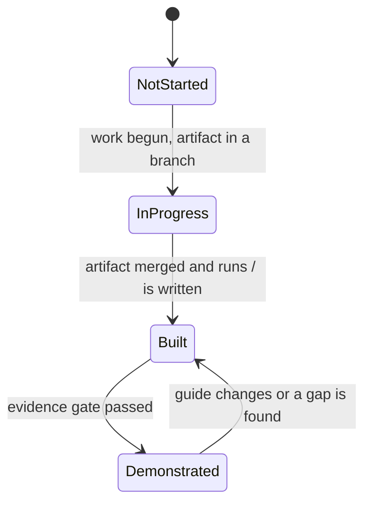

# Objective Tracker: Exam Coverage Matrix

One row per official objective (see [`official-domain-map.md`](official-domain-map.md)). **Nothing is demonstrated yet.** The repo currently holds no notes, code, diagrams or practice questions, so every Notes cell is empty and every status is *Not started*.

## How a status is earned

- **Not started → In progress:** I have begun the experiment or document.
- **In progress → Built:** the artifact is in `main`, and runs (code) or is complete (document).
- **Built → Demonstrated:** all three gates pass: (1) an artifact in the repo, (2) a test or measurement where the objective allows one, (3) I can explain the *why* and the trade-offs aloud without notes (the self-test question in the evidence column).
- **Demonstrated → Built:** demotion is allowed. A new guide version or a discovered gap sends the row back.

## Experiment key

The sequence is the one you proposed; E-numbers are the planned experiments, **C** is a capstone phase, **DOC** is a documentation deliverable that is not an experiment. Detailed ordering is Step 4.

| Key | Experiment |
|---|---|
| E1 | Claude API application |
| E2 | Agent and tool orchestration |
| E3 | MCP integration |
| E4 | Enterprise RAG |
| E5 | Evaluation and observability |
| E6 | Enterprise governance |
| E7 | Production architecture |

Rows marked ⚑ are **blueprint gaps**: objectives your original portfolio covered thinly or not at all, now given a home.

## Summary

| Domain | Weight | ≈ items | Objectives | Demonstrated |
|---|---:|---:|---:|---:|
| 1 Solution Design & Architecture | 17% | 11 | 6 | 0 / 6 |
| 2 Models, Prompting & Context | 13% | 8 | 5 | 0 / 5 |
| 3 Integration | 19% | 12 | 8 | 0 / 8 |
| 4 Evaluation, Testing & Optimization | 16% | 10 | 6 | 0 / 6 |
| 5 Governance, Safety & Risk | 14% | 9 | 5 | 0 / 5 |
| 6 Stakeholder & Lifecycle | 14% | 9 | 5 | 0 / 5 |
| 7 Developer Productivity | 7% | 4 | 3 | 0 / 3 |
| **Total** | **100%** | **63** | **38** | **0 / 38** |

## Domain 1: Solution Design & Architecture (17%)

| ID | Notes | Proposed experiment | Evidence required (self-test question) | Status |
|---|---|---|---|---|
| 1.1 | none | E1 + C: business problem statement per experiment; capstone discovery brief | Problem statement and solution-mapping ADR. *Why is Claude the right tool here, and where would a rules engine do better?* | Not started |
| 1.2 | none | E1, then C Phase A | Component and sequence diagrams that match the running code, including a feedback loop (user rating stored and used). *Where does feedback re-enter the system?* | Not started |
| 1.3 | none | E2: one task built as single-shot, workflow and agent | Side-by-side results (quality, latency, cost), ADR, and a written "when NOT to use an agent". *Which pattern would you pick for a fixed 4-step claims check, and why?* | Not started |
| 1.4 | none | E2 then C Phase D: orchestrator plus specialist agents | Working delegation with controlled handoffs, state diagram, failure of one sub-agent handled. *What breaks if a sub-agent returns garbage?* | Not started |
| 1.5 | none | E2: same complex task decomposed three ways | Measured comparison of decompositions with a recommendation. *When does decomposition hurt?* | Not started |
| 1.6 ⚑ | none | DOC: value-pillar table in every experiment README; C cost and SLA targets | Filled value mapping for at least E1, E4 and the capstone. *How would you justify this to a CFO?* | Not started |

## Domain 2: Claude Models, Prompting & Context Engineering (13%)

| ID | Notes | Proposed experiment | Evidence required (self-test question) | Status |
|---|---|---|---|---|
| 2.1 | none | E1 + E5: one eval set run across model tiers | Table of quality, latency and cost per model, plus a selection ADR. Model IDs pinned from the official docs at build time. *When is the cheapest tier enough?* | Not started |
| 2.2 | none | E1: system prompt, template and guardrail variants | Versioned prompt files, tests that check guardrail behaviour. *What belongs in the system prompt versus the user turn?* | Not started |
| 2.3 | none | E1: zero-shot vs few-shot vs chain-of-thought on the same task | Measured accuracy and token cost per technique. *When does CoT not pay for itself?* | Not started |
| 2.4 | none | E1: token measurement, and a forced context-limit scenario | Token counts per request, plus a demonstrated truncation or summarization strategy when the limit is hit. *What is lost at each strategy?* | Not started |
| 2.5 | none | E1 (caching), E3/E7 (Skills, modular prompts) | Cached vs uncached latency and cost with static content ordered first; one reusable Skill. *Why does prefix order matter for caching?* | Not started |

## Domain 3: Integration (19%)

| ID | Notes | Proposed experiment | Evidence required (self-test question) | Status |
|---|---|---|---|---|
| 3.1 ⚑ | none | E2: same task with a small, medium and bloated tool set | Measured tool-selection accuracy and token overhead, plus a written audit of the bloated set. *Which tools would you remove first?* | Not started |
| 3.2 | none | E3 + E4 + E6: role-based document access and a flawed design to audit | Working authorization at retrieval time, plus a written gap analysis of a deliberately flawed design. *Where is the trust boundary?* | Not started |
| 3.3 | none | E5: vary model, retrieval depth and effort settings | Accuracy-vs-latency curve and a justified chosen configuration. *What would make you accept slower answers?* | Not started |
| 3.4 ⚑ | none | E5 + E7: tracing and logging, then a scale analysis | Working traces, and a written analysis of sampling, retention and cost at 100x volume. *What do you stop logging first?* | Not started |
| 3.5 | none | E4: ingestion, chunking, embeddings, indexing | Working pipeline plus a chunking-strategy comparison on the same corpus. *Why did the chunk size you chose win?* | Not started |
| 3.6 | none | E4: keyword vs vector vs hybrid, with metadata filters | Retrieval precision and recall per strategy on a labelled set. *Which data shape favours keyword search?* | Not started |
| 3.7 | none | E3: one capability built as direct tool, MCP server and CLI | Working implementations, a decision matrix, and a sequence diagram of each. *When is MCP not worth it?* | Not started |
| 3.8 | none | E3 + E4: load-everything vs on-demand discovery | Measured token and accuracy difference between the two. *What does on-demand discovery cost you?* | Not started |

## Domain 4: Evaluation, Testing & Optimization (16%)

| ID | Notes | Proposed experiment | Evidence required (self-test question) | Status |
|---|---|---|---|---|
| 4.1 | none | E5 | Written metric definitions covering accuracy, latency, cost, safety and security, with how each is computed. *Which metric would you gate a release on?* | Not started |
| 4.2 | none | E5: golden set, code-graded checks, LLM judge, human spot check | Versioned dataset and a runnable eval harness with regression tests. *How do you know your judge is reliable?* | Not started |
| 4.3 | none | E5: prompt A vs prompt B | Experiment report with sample size reasoning and the limits of the conclusion. *Why is a 5-example win not evidence?* | Not started |
| 4.4 | none | E5: seeded faults (stale index, bad prompt, wrong model) | Diagnosis write-up for each seeded fault showing how it was isolated. *What do you check first when answers are confidently wrong?* | Not started |
| 4.5 | none | E1 + E5: caching, routing, prompt trimming | Before/after cost and latency measurements. *What did the optimization cost in quality?* | Not started |
| 4.6 | none | E5 + E7: structured logs and a dashboard | Working logs and a dashboard or report with alert thresholds. *What would page you at 3 a.m.?* | Not started |

## Domain 5: Governance, Safety & Risk Management (14%)

| ID | Notes | Proposed experiment | Evidence required (self-test question) | Status |
|---|---|---|---|---|
| 5.1 | none | E6: input and output validation, PII redaction, permission limits | Tests that show each control blocking a bad case, and stating its residual risk. *What does each guardrail not catch?* | Not started |
| 5.2 | none | E6: prompt injection demo and a risk register | Working attack and mitigation, plus a populated risk register. *How does injection arrive through a retrieved document?* | Not started |
| 5.3 | none | E2 + E6: approval gate on sensitive tools | Working approval flow, with audit log entries, and a denial path. *Which actions must never be autonomous?* | Not started |
| 5.4 | none | E6 + DOC: requirements-to-controls mapping for GDPR, HIPAA, FedRAMP | A mapping document that states clearly it is not a compliance claim. *What does a regulator ask for that code can't show?* | Not started |
| 5.5 ⚑ | none | E6 + E4: bias probe set, and citation-based transparency | A small bias test set with results, plus an explanation of how citations support transparency. *What bias could affect a policy-Q&A assistant?* | Not started |

## Domain 6: Stakeholder Communication & Lifecycle Management (14%)

| ID | Notes | Proposed experiment | Evidence required (self-test question) | Status |
|---|---|---|---|---|
| 6.1 | none | DOC + C: discovery questionnaire and requirements for the capstone | Completed discovery doc with functional and non-functional requirements. *Which question exposes the real constraint?* | Not started |
| 6.2 | none | DOC: ADRs plus four audience briefings (engineering, security, product, business) | At least 3 ADRs and one briefing per audience for the capstone. *How does the security briefing differ from the business one?* | Not started |
| 6.3 | none | DOC: SLO sheet and a feedback-to-iteration log | SLOs with measurable targets and a log showing feedback changing a decision. *What do you do when stakeholder expectations exceed the SLA?* | Not started |
| 6.4 | none | DOC: per-experiment README template, handoff guide | Every experiment README complete, plus one handoff guide for the capstone. *Could someone else run this from the README alone?* | Not started |
| 6.5 | none | DOC + E7: lifecycle plan, versioning, deprecation, rollback | Lifecycle plan covering the five phases, with a rollback procedure that has been rehearsed. *How do you retire a prompt version safely?* | Not started |

## Domain 7: Developer Productivity & Operational Enablement (7%)

| ID | Notes | Proposed experiment | Evidence required (self-test question) | Status |
|---|---|---|---|---|
| 7.1 | none | E3/E7: CLAUDE.md, shared settings, permissions, hooks, MCP config in this repo | Committed config that uses least-privilege permissions and a hook that blocks a risky action. *What does a team lose by allowing everything?* | Not started |
| 7.2 | none | E7: a reusable Skill, a code-review workflow, a CI job | Working Skill and CI run on a real change. *What should stay out of automation?* | Not started |
| 7.3 | none | E7: debugging runbook from a real failure in this lab | Runbook written from an actual incident, with symptoms, steps and root cause. *How did you separate a prompt bug from a code bug?* | Not started |

## Coverage observations

- **Heaviest demand:** Domain 3 has 8 objectives and about 12 items. E2, E3 and E4 together cover 7 of its 8 rows, so these three experiments carry the most exam value.
- **Documentation-only rows:** 1.6, 6.1 to 6.5 and parts of 5.4 are mostly documents. They are 14% of the exam in Domain 6 alone, so don't treat them as "after the code".
- **Not covered by any experiment yet:** agent-to-agent communication (part of 3.7) has no dedicated build; I'd cover it as a written comparison unless you want a small build.
- **No practice-question bank exists.** The guide has 3 samples. I propose writing your own scenario questions per objective into `exam-blueprint/notes-index.md` as you go, never reproducing live exam items.
